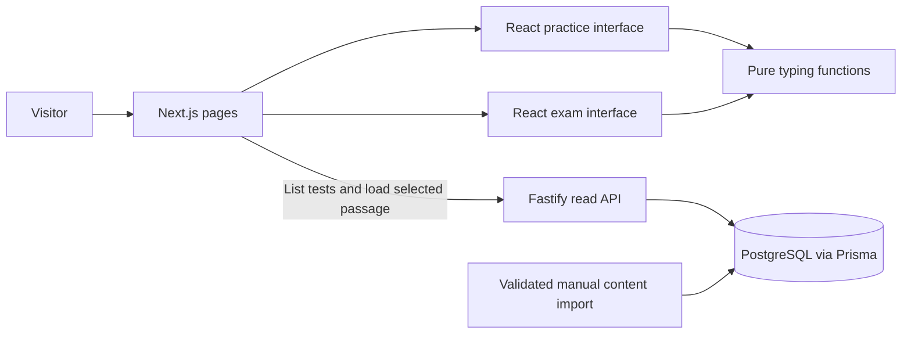

# Aptus typing application: full-stack implementation plan

Date: 12 November 2026
Branch: `codex/typing-practice-plan`
Status: practice implemented locally; storage contract proposed for review. See section 10.

## 1. Goal and agreed boundaries

Bring Hemant's existing typing application into Aptus as a useful public tool:

- Practice mode matches Aptus's clean light/dark style.
- Exam mode preserves the supplied assessment interface and aims to resemble
  the real exam closely. It does not inherit the practice redesign.
- Use native Next.js pages and React components; reuse the framework-independent
  typing functions rather than replacing the developer's work wholesale.
- Store previous-year passages and their exam configuration in PostgreSQL.
- Decide actual duration, Backspace policy, scoring and thresholds when each
  exam configuration is prepared for storage. This plan invents no official rule.
- Implement **one mode at a time**. Proposed order: practice, then exam.
- This task writes the plan. It does not authorize implementation or deployment.

The earlier [integration audit](TYPING_INTEGRATION_PLAN.md) records the source
code, 30 passing tests and discovered defects. Its separate-HTML recommendation
is superseded by this plan. Its findings remain relevant. The overall Aptus
roadmap is not silently reprioritized by this feature plan.

## 2. Architecture decision and reasons



| Layer                     | Owns                                                                    | Does not own                                         |
| ------------------------- | ----------------------------------------------------------------------- | ---------------------------------------------------- |
| Next.js                   | Page URLs, metadata, server-rendered page structure, existing API proxy | A second database or competing typing API            |
| React                     | Local input, session state, timer display, focus, dialogs and results   | Official exam-rule inference                         |
| Pure TypeScript functions | Evaluation, elapsed-time arithmetic, policy decisions and scoring       | DOM access, fetching, database writes                |
| Fastify                   | Validated catalogue/detail requests and bounded responses               | Per-keystroke requests or browser-triggered scraping |
| Prisma/PostgreSQL         | Published passage content, versioned rules and provenance               | A live session's mutable timer                       |
| Content import script     | Validates and previews deliberate content changes                       | Automatic publication of unreviewed papers           |

This follows Aptus's existing split: Next frontend, Fastify application API,
Prisma/PostgreSQL persistence. Keep the Python recruitment worker independent.
No new framework, state library, queue, cache service or AI dependency is needed.

## 3. Pages, layouts and component ownership

| URL                        | Purpose                                     | Presentation                           |
| -------------------------- | ------------------------------------------- | -------------------------------------- |
| `/typing`                  | Random words/custom-text practice           | Aptus shell and light/dark theme       |
| `/typing/exam`             | Choose a published exam version and passage | Compact exam introduction and selector |
| `/typing/exam/[passageId]` | Load and run one selected exam              | Dedicated full-screen assessment shell |

Keep one minimal `app/layout.tsx` for the document. Move the existing site shell
into an `(site)` route-group layout, keeping existing URLs unchanged. Place the
exam routes in a separate `(assessment)` group. Route-group names are not URL
segments. Practice remains in the site group; assessment pages omit Aptus's
normal header, width-constrained main, footer and fixed mobile navigation.

Retain WorkspaceProvider and local design-review behavior for existing site
pages. Do not make typing depend on applicant profile or authentication. Keep
existing site CSS scoped away from the assessment group; moving a CSS import
alone is not sufficient evidence of isolation during client navigation. Use
CSS Modules for typing and test site -> exam -> site transitions in both themes.
Share a minimal reset deliberately; do not copy broad body/header/button rules.

Pages remain Server Components where possible. Put browser interaction inside
focused Client Components. Browser APIs and randomized passages must not run
during server rendering in a way that causes hydration mismatches. An explicit
start action can initialize a random practice passage in the browser.

Suggested ownership, with exact module count kept proportional to real code:

```text
app/(site)/typing/page.tsx
app/(assessment)/typing/exam/page.tsx
app/(assessment)/typing/exam/[passageId]/page.tsx
components/typing/practice-session.tsx + CSS Module
components/typing/exam-session.tsx + CSS Module
lib/typing/                  shared types and pure functions only
src/routes/typing.ts         Fastify read endpoints
src/lib/typing-catalogue.ts  explicit Prisma reads and response projections
scripts/import-typing-content.ts
```

The proposed shared `lib/typing` location needs review against both TypeScript
projects and Docker COPY rules. Keep imported pure source available to frontend,
API and tests; do not place it under `frontend/` merely to reuse its legacy emit
configuration. Add only the shared files actually consumed by a given image.

Start discoverability with an existing footer link. A fourth mobile navigation
tab is a separate UX decision because current navigation assumes three columns.

## 4. Database design: small catalogue, explicit versions

Use three related entities. These are proposed fields, not a migration already
written. Keep typing records separate from recruitment Post and applicant User.

### TypingExam: stable identity

| Field                    | Meaning                                                         |
| ------------------------ | --------------------------------------------------------------- |
| `id`                     | Internal stable identifier                                      |
| `slug`                   | Unique catalogue key, such as a reviewed exam-family identifier |
| `name`, `organization`   | Display identity; organization nullable when unknown            |
| `createdAt`, `updatedAt` | Maintenance timestamps                                          |

### TypingExamVersion: one explicit set of rules

| Field                                              | Meaning                                                                                    |
| -------------------------------------------------- | ------------------------------------------------------------------------------------------ |
| `id`, `examId`                                     | Version identity and parent exam                                                           |
| `versionKey`, `label`                              | Unique key within exam and human-readable edition                                          |
| `examYear`, `language`                             | Year nullable if unspecified; supported language explicit                                  |
| `durationSeconds`                                  | Positive integer; nullable only while draft                                                |
| `backspacePolicy`                                  | `UNRESTRICTED`, `DISABLED`, `CURRENT_WORD_ONLY`; unknown stays null in draft               |
| `editingPolicy`                                    | Supported named policy covering cursor movement, selection, Delete and insertion           |
| `scoringMethod`                                    | Supported code-owned enum/version, not executable code or an arbitrary formula             |
| `targetWpm`, `maxErrorPercent`, `targetKeystrokes` | Separate nullable numeric fields; store only requirements supported by the selected method |
| `instructions`                                     | Plain-text exam instructions                                                               |
| `ruleSourceUrl`, `ruleSourceNote`                  | Evidence URL/reference and page/section details                                            |
| `status`                                           | `DRAFT`, `PUBLISHED`, `RETIRED`                                                            |
| `reviewedAt`, `publishedAt`, `createdAt`           | Review/publication provenance                                                              |

Do not introduce a generic JSON rules engine. Add a typed field or a specific
scoring method only when a real supported exam needs it. Editing-policy values
and scoring-method values are frozen with the first stored exam, after its
instructions are reviewed. A preset with unresolved required behavior stays a
draft rather than receiving a guessed default.

Qualification is nullable: if the scoring method's required thresholds are
unknown, show measured speed/accuracy and “qualification not assessed.” Do not
label a visitor qualified just because a missing threshold became zero.

### TypingPassage: one selectable paper/passage revision

| Field                                    | Meaning                                                                    |
| ---------------------------------------- | -------------------------------------------------------------------------- |
| `id`, `examVersionId`                    | Passage identity and exact applicable rules                                |
| `contentKey`, `revision`                 | Stable content key with explicit revision number; unique together          |
| `title`, `examYear`, `shift`             | Display metadata; year/shift nullable when unspecified                     |
| `text`                                   | Approved plain text; preserve case, punctuation and meaningful line breaks |
| `contentHash`                            | Server/import-computed hash of canonical stored text                       |
| `sourceKind`                             | `OFFICIAL_PREVIOUS_YEAR`, `RECONSTRUCTED`, `PRACTICE`                      |
| `sourceUrl`, `sourceNote`                | Provenance and document/page reference                                     |
| `status`                                 | `DRAFT`, `PUBLISHED`, `RETIRED`                                            |
| `reviewedAt`, `publishedAt`, `createdAt` | Review and publication timestamps                                          |

Compute character/word counts from stored text with one documented counting
convention. Return derived counts in API metadata; do not accept the old
handwritten counts as authoritative. If counts are materialized later, derive
them on write with the same helper, never editable independent values.

Use foreign keys with restrictive deletion for published relations. Index
exam/version/status and passage/version/status plus ordering fields used by
actual queries. Avoid adding indexes to every field. Inspect query plans when
fixtures reach realistic catalogue sizes.

### Version and publication policy

- Publish only complete, reviewed rule versions with a supported implementation.
- A public passage requires both its own status and its rule version's status
  to be PUBLISHED. Apply the same condition in list and direct-detail queries.
- Treat published text and rules as immutable. A correction creates a new
  version/revision; retire the old record without deleting source history.
- Freeze passage text and rules in browser memory before the first key. A
  background update must not change a running session.
- A retired item cannot start a new public session. An already-loaded local
  session may finish using its original snapshot.
- Hash equality detects repeated content; it does not establish authenticity.

## 5. Content entry: decide rules while storing

Begin with a manually reviewed import file and a small script, rather than an
admin dashboard or automated paper scraper.

1. Select one exam and one passage. Record the actual source and edition.
2. Enter its duration, editing policies and scoring method together with the
   source instruction supporting them. Leave unresolved facts null in a draft.
3. Label passage provenance honestly. A sample or reconstructed passage must
   not be described as an official previous-year paper.
4. Preview text exactly as it will appear; show derived counts and all rules.
5. Validate input shape, bounds, known enums, encoding, nonempty text, provenance
   and whether the scorer supports the configuration.
6. Dry-run by default. Show intended inserts, revisions and no-op duplicates.
7. Apply an explicit write operation in a database transaction. Validate the
   whole import before mutating it; repeated imports must not duplicate records.
8. Read back and compare stored text, hash, metadata and rule fields. Publish
   deliberately only after the selected configuration passes its acceptance test.

Canonicalize encoding and line endings deliberately, then hash the actual stored
text. Do not collapse whitespace or rewrite punctuation without review: doing
so changes the passage being assessed. Never silently overwrite published rows.
The script uses existing database configuration without printing credentials.

Initial source-project passages must be imported as drafts or honestly labeled
practice content until their previous-year provenance and rule claims are checked.
All four current stored character counts differ from their actual text lengths.

## 6. Read API and bounded loading

Add routes to the existing Fastify application and use the existing Next API
rewrite. Do not add parallel Next database handlers for the same feature.

| Endpoint proposal                                             | Response and use                                                                                                                 |
| ------------------------------------------------------------- | -------------------------------------------------------------------------------------------------------------------------------- |
| `GET /api/typing/exams?page=1&pageSize=20`                    | Paginated published exam-version summaries with parent exam identity; explicitly document that each selectable item is a version |
| `GET /api/typing/passages?examVersionId=…&page=1&pageSize=20` | Passage summaries for the selected version; no full passage text                                                                 |
| `GET /api/typing/passages/:id`                                | One published passage plus its exact supported rule configuration                                                                |

List responses use `{ data, pagination }` in the existing Aptus style. Detail
responses contain passage identity/revision/hash, plain text, source metadata,
derived counts and an explicit rules object. Neither response exposes database
internals, draft notes, reviewer identities or unrelated account information.

Proposed limits: page size default 20/max 50, page max 10000, identifiers bounded
to 128 characters, passage text max 50,000 characters at import. These are
implementation limits to confirm against real examples, not official exam limits.
Reject malformed, duplicate or unsupported query parameters with 400; missing,
draft or retired detail with 404; temporary database failure with 503 and a
meaningful generic error. Use deterministic ordering with an ID tie-breaker.

Start with fresh catalogue/detail reads (`no-store`) and no Redis. Select only
metadata columns in list queries; load full text only for the chosen passage.
Avoid a full-passage module bundled into every client route. A detail page may
fetch its selected data on the server and pass it to the Client Component once;
do not immediately fetch the same detail again on mount.

Validate imported data and API responses at runtime; TypeScript types alone
are insufficient. Final field presence/nullability and errors need a reviewed
contract before dependent code is built. This proposal does not modify the
existing protected contract files or their lock.

## 7. Session engine and input behavior

Use a small explicit lifecycle: `idle -> running -> finished`; practice also
supports `running <-> paused`. Restart discards the old session and creates a new
one. Exam mode does not acquire practice pause behavior through a shared helper.

- Keep one authoritative text value and a distinct keystroke history only when
  the selected scoring method needs it. Final text and attempted keystrokes
  have different meanings; name and test them separately.
- Use a real labeled textarea/input. Reconcile `beforeinput`/`input`, selection
  and composition events; a global keydown listener is insufficient for mobile
  keyboards, replacement edits, IME and accessibility.
- Enforce editing policy consistently across Backspace, Delete, selected-text
  replacement, cursor movement, clipboard actions and composition. Unknown or
  unsupported combinations cannot be published as supported exams.
- Keep handlers within the typing workspace. Never count Ctrl/Cmd shortcuts as
  typed letters or block navigation everywhere in Aptus.
- Use monotonic elapsed-time arithmetic. Interval ticks update the display;
  elapsed time and the chosen deadline decide expiration. Check expiry again
  before accepting input and on submission; cap scored elapsed time according
  to the agreed method, avoiding extra time from a delayed callback.
- Practice pauses on the agreed focus/visibility transition; exam continues.
  Navigation/refresh may discard v1 sessions, with an active-exam warning.
- Clean up listeners/intervals on restart and unmount; check React development
  Strict Mode does not create duplicate timers or event listeners.
- Scope restart shortcuts to the appropriate mode. Do not carry practice's
  Escape-to-reset shortcut into an active exam without an explicit decision.
- Render user/custom/source text through React text nodes, never raw HTML.

Migrate production functions first with behavior tests. Existing evaluation
tests target an older duplicate module; move useful assertions to the actual
shared evaluator. Exclude the old standalone wpm.js calculation and probes from
production. Define supported character counting and whitespace rules before
using length/index arithmetic for multilingual input.

English is the first supported language. Do not advertise Hindi/IME exam support
until its layout, input method, counting and marking rules are implemented and
tested. Unexpected composition input must not silently produce a valid score.

## 8. UI/UX acceptance

### Practice: finish and review before starting exam UI

Preserve Words/Custom text, 15/30/60/custom duration, first-input timer start,
character feedback, pause/resume, restart, live statistics and result summary.
Use Aptus colors, spacing, typography, focus styling and automatic light/dark
behavior. Keep controls compact and the passage prominent. Use a labeled
duration field rather than a browser prompt. Show score definitions plainly;
ordinary practice should use a performance summary rather than an unverified
official Qualified/Disqualified claim.

Check idle, running, paused, custom-entry and completed states at 390, 834 and
1440px widths, plus browser zoom. Use adequate untyped-text contrast, reduced
motion, modal semantics/focus containment/return and keyboard-operable controls.

### Exam: preserve appearance, make data reliable

Use the original navy/white assessment baseline: compact header, candidate
placeholder, timer, passage selector, A-/A/A+, manual master-passage scroll,
typing area, policy indicator, counters, confirmation and scorecard. Use clearly
fictional candidate details; do not reuse applicant DOB/category/profile data.
Label the product as a simulator rather than an official assessment service.

Show rule/source information before starting. Lock exam/passage selection
during an active session or require an explicit discard confirmation. Freeze
text/rules at start. Keep the master passage manual-scrolling. Handle loading,
empty catalogue, missing/retired paper, API failure and retry before the timer
starts. A failed data request must not leave a half-initialized exam running.

Capture comparison screenshots before and after migration. Check constrained
heights, zoom, mobile keyboard viewport changes, dialog scrolling and return to
practice. “Close to the real exam” needs the selected exam's visual reference;
the existing project remains the initial baseline until that reference exists.

## 9. Results, privacy and persistence boundary

The initial database stores catalogue content and configuration, **not attempts**.
Visitors can use practice and exam mode signed out. Input stays in browser memory;
no per-key analytics or server upload of custom passages/keystroke logs.

Client results are personal practice estimates and can be manipulated. Browser
clipboard restrictions are not a secure anti-cheat boundary. Do not use these
results for official certification or a trusted leaderboard.

If account history is later requested, design it as a separate slice: use the
existing server session identity, store the immutable passage/rule/scorer
versions, define retention/deletion and ownership, and decide what evidence
supports server-side recalculation. Posting a client-provided WPM is not trusted
verification. Do not add an attempt table preemptively.

## 10. Implementation sequence and completion evidence

### Implementation status — 12 November 2026

The user has now authorized implementation using OpenCode free GLM and DeepSeek agents, coordinated and independently reviewed in [the typing team batch](AGENT_COORDINATION_2026-11-12-typing.md). This supersedes the planning-only authorization note below; scope remains one mode at a time.

| Slice | Verified current status                                                                                                                                                                                                | Remaining work                                                                                                     |
| ----- | ---------------------------------------------------------------------------------------------------------------------------------------------------------------------------------------------------------------------- | ------------------------------------------------------------------------------------------------------------------ |
| 0     | Source audit and scoring probes complete; frozen practice contract and isolated baselines recorded                                                                                                                     | Browser evidence is recorded with practice; no official exam visual claim                                          |
| 1     | GLM implementation and coordinator fixes verified:27 combined tests and 8 typing browser checks passed; DeepSeek accepted targeted fixes on static review                                                              | Local integration/release evidence is in TYPING_IMPLEMENTATION_REVIEW.md; real OS/mobile IME testing remains unrun |
| 2     | Draft storage/import reviewed by Terra and integrated locally; 53 earlier database/pure checks and 38 post-fix pure checks pass. [Current evidence](TYPING_STORAGE_IMPLEMENTATION_REVIEW.md). Read API not implemented | Implement the public read API next; official rules remain content-entry decisions                                  |
| 3     | Not started                                                                                                                                                                                                            | Preserve source exam appearance after storage/API slice                                                            |
| 4     | Practice frontend Docker source inclusion added; runtime checks passed; no release performed                                                                                                                           | Existing unrelated type errors block a clean standard build; image execution and deployment remain unrun           |

Agent rationale and review reports will accompany the accepted implementation. No production database, worker, deployment or paid model changes are included.

| Slice                                  | Deliverable                                                                                     | Done when                                                                                                                                                   |
| -------------------------------------- | ----------------------------------------------------------------------------------------------- | ----------------------------------------------------------------------------------------------------------------------------------------------------------- |
| 0. Baseline and shared behavior        | Preserve source, actual production-function tests, supported input/counting definition          | Known source-audit findings reproduced; no formulas silently changed; baseline screenshots captured when browser works                                      |
| 1. Practice only                       | `/typing`, focused React session, Aptus style and entry link                                    | One complete session works through input, corrections, pause, completion and restart; responsive/theme/accessibility checks pass                            |
| 2. Storage and read API                | Three models, additive migration, dry-run import, paginated reads and one reviewed exam fixture | Import is validated/idempotent; read-back matches; drafts hidden; list omits text; selected detail returns exact rules; no exam UI work mixed in            |
| 3. Exam only                           | Separate layout, selectors, selected passage and faithful React assessment interface            | Complete selected exam works with its stored configuration; visuals match baseline; all editing policies actually published have behavioral checks          |
| 4. Integration and release preparation | Built images, regression checks, docs and concrete release record                               | Frontend/API images contain required modules; empty/failure/retired states work; existing Aptus flows pass; migration/deploy/rollback instructions reviewed |

Finish each slice and review its evidence before beginning the next mode.
The content-storage slice can define rules with Hemant as the first exam is
entered. Do not block practice on deciding every possible exam rule.

## 11. Verification plan

| Layer             | Essential checks                                                                                                                                                            |
| ----------------- | --------------------------------------------------------------------------------------------------------------------------------------------------------------------------- |
| Pure functions    | Actual evaluator, correction semantics, score examples, missing thresholds, invalid elapsed time, exact boundaries, all supported editing policies                          |
| Content import    | Empty/oversized text, invalid enums, unknown draft rules, publication rejection, derived counts, transaction rollback, repeated no-op import, immutable revision protection |
| Database          | Disposable test DB: additive migration, FK behavior, ordering/pagination, version selection, draft/retired filtering and read-back integrity                                |
| Fastify           | Existing inject pattern: 200/400/404/503, bounded queries, invalid/duplicate parameters, no full text in list, exact passage/rule association                               |
| React/browser     | Practice lifecycle; exam lifecycle; real keyboard input/corrections; delayed deadline; focus/composition behavior; restart/unmount cleanup; dialogs and navigation          |
| Visual/regression | 390/834/1440 widths, both practice themes, fixed exam palette, zoom/reduced motion, site/exam transitions, Home/Saved/Profile/sign-in and no-JS public browsing             |
| Build/artifact    | `pnpm typecheck`, `pnpm lint`, relevant existing tests, frontend build and both image import/startup checks                                                                 |

Interactive typing requires JavaScript; provide an honest no-JS message while
keeping existing job browsing usable. Extend relevant tests instead of copying
the same scoring implementation into a second test helper. Database tests must
use an explicitly disposable database, never production credentials.

The original planning-only checkpoint claimed no implementation checks. Current
practice verification is recorded in [the implementation review](TYPING_IMPLEMENTATION_REVIEW.md):
35 combined checks pass and repository lint passes. The earlier 30/30 still
refers only to the original source-project suite. Database, exam and release
checks remain unrun.

## 12. Deployment and rollback plan

Use an additive migration, reviewed before applying it. Practice can ship as a
frontend-only slice; database-backed exam requires migration -> compatible API
-> reviewed content -> frontend. An empty catalogue is a valid handled state,
not a reason to insert unverified public fixtures.

Confirm Docker inputs include any new shared pure modules and API import code.
The earlier static `public/typing` COPY change is unnecessary for this native
React approach unless real static assets are added. Do not package test probes,
source evidence files or import credentials as public assets.

Before actual operations read `SERVER_DEPLOYMENT.md` and the current release
instructions. Frontend/API deploy through Coolify only after authorization.
No worker image or cron change is required. Verify source SHA -> image revision
and digest -> running container -> requested route. Record observed results.

Rollback restores compatible frontend/API images while retaining additive
catalogue tables. Retire problematic content to stop new sessions. Do not drop
tables, delete source history or mutate unrelated applicant/job data to roll back.

## 13. Decisions deliberately deferred to content entry

- Exact official duration, Backspace/editing policy and start/finish behavior.
- Exact marking method, treatment of corrected mistakes, omissions/insertions,
  punctuation/case, word definitions and category/language-specific cutoffs.
- Which papers are truly previous-year originals and their source evidence.
- Which exam/version is published first and what visual reference applies.

Capture these as reviewed stored configuration plus executable score examples
for the first supported exam. The interface does not infer them from an exam name.

Deferred beyond the requested initial feature: accounts/history, leaderboards,
admin dashboard, automatic PDF ingestion, Hindi support, coaching subscriptions,
offline recovery and recommendations. Add one only when its actual need is agreed.

## 14. Immediate next step

Slices 0–1 are now implemented and locally reviewed; see the status table in
section 10 and the implementation review. The original source project and
unrelated staged/unstaged Aptus work are preserved. The accepted source was
frozen in an isolated local commit; only reviewed files were copied back.

Next is slice 2, storage and read API, with the first exam configuration decided
when content is entered. Exam mode follows that slice. No push, deployment,
production migration or publication is included in the practice implementation.

Storage preparation update: the requested free agents have completed design
assignments. See [the storage batch](AGENT_COORDINATION_2026-11-12-typing-storage.md)
and [the coordinator-reviewed contract proposal](TYPING_STORAGE_CONTRACT_PROPOSAL.md).
This subdivides slice 2 into draft storage/import first, public API next. No
contract freeze, database implementation or migration application is claimed.

Draft-storage implementation update: see [the current handoff](TYPING_STORAGE_IMPLEMENTATION_REVIEW.md).
Code is frozen on the isolated review branch; 53 focused typing checks and the
broader backend/contract suite passed. Final free-model review is blocked by
provider request failures, so original application source is not yet updated.

12 November follow-up: Hemant requested GPT-6.1 Terra for the pending exact-commit
review. Assigned task `01a1d003-ff79-70d2-80d2-4d8da7e0358d`; verdict pending.

Responsive acceptance requirement (Hemant): all typing pages must work on mobile,
tablet and desktop. Verify narrow and wide viewports, passage wrapping, reachable
controls, keyboard focus/input and absence of unintended horizontal overflow.
Practice retains Aptus light/dark styling; exam preserves its original visual
reference while adapting its layout to smaller screens. Record observed browser
checks separately; this requirement is not yet a completed verification claim.

Storage integration update: Terra completed the independent review, the C1
metadata validation finding was fixed and reviewed at `5d46aaf1`, and the 12
owned storage/import paths are integrated locally. Prisma generation/validation,
lint and 38 pure tests pass. No application DB migration or deployment.
Public read API and exam UI remain next; earlier provider-blocked status is
historical. See the current storage handoff for full evidence and limits.
